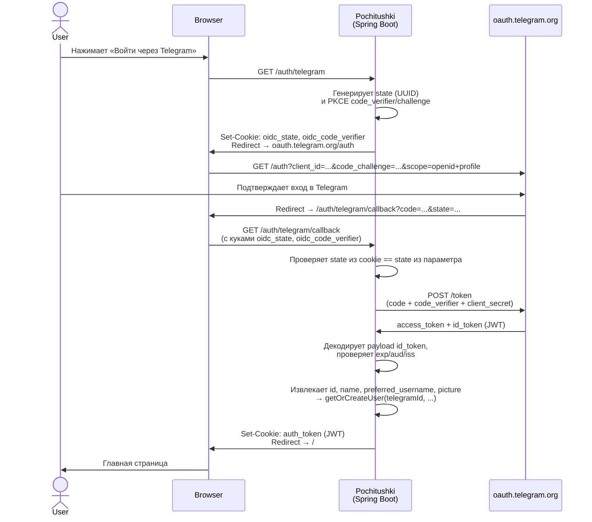
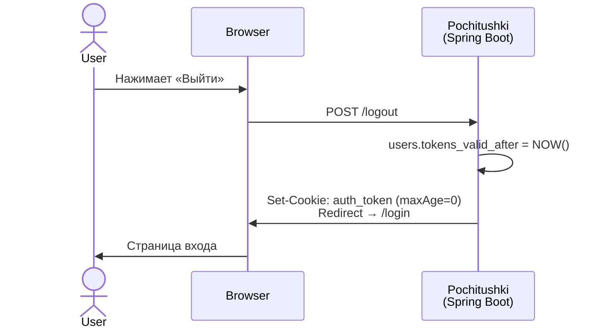
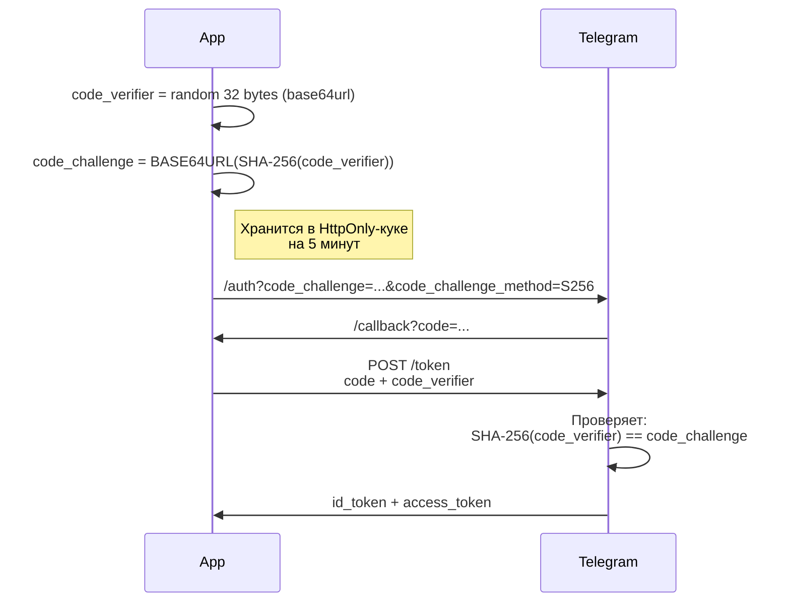

# Pochitushki Service

[](https://github.com/proshik/pochitushki/actions/workflows/build.yml)
[](https://github.com/proshik/pochitushki/actions/workflows/release.yml)
[](https://github.com/proshik/pochitushki/releases/latest)
[](https://github.com/proshik/pochitushki/pkgs/container/pochitushki)
[](https://github.com/proshik/pochitushki/commits)

[](https://kotlinlang.org)
[](https://spring.io/projects/spring-boot)
[](https://adoptium.net)
[](https://www.postgresql.org)
[](LICENSE)

Сервис «отложенного чтения» (read-it-later), аналог Pocket. Ссылки можно сохранять
и читать двумя способами: через **Telegram-бота** и через **веб-интерфейс** со
входом по Telegram-аккаунту. Оба интерфейса работают с одними и теми же данными.

## Основные возможности

- **Сохранение ссылок**: отправьте ссылку боту или добавьте её на веб-странице.
- **Лента и разделы**: непрочитанное, все ссылки, архив, избранное.
- **Архивация**: убирайте прочитанное в архив и возвращайте обратно.
- **Избранное**: отмечайте ссылки звёздочкой.
- **Удаление**: удаляйте ненужные ссылки.
- **Метки**: вешайте на ссылки метки и открывайте подборки по ним.
- **Случайная ссылка**: получите случайную ссылку из списка для чтения.
- **PDF**: сохраняйте статью по ссылке в PDF (доступно из бота).
- **Импорт из Pocket**: загрузите ZIP-архив с экспортом из Pocket.
- **Экспорт**: выгрузите свои данные ZIP-архивом с CSV внутри (доступно из бота).
- **Два языка интерфейса**: русский и английский. Начальный язык берётся из
  Telegram, потом его можно сменить в профиле (бот или веб).

### Команды бота

| Команда | Действие |
|---|---|
| `/start` | Регистрация и приветствие |
| `/help` | Справка |
| `/feed` | Лента непрочитанных ссылок |
| `/random_post` | Случайная ссылка |
| `/archive` | Архив |
| `/favorites` | Избранное |
| `/profile` | Профиль и настройки |

Ссылка, отправленная боту обычным сообщением, сохраняется автоматически.

### Карточка поста в боте

`/feed`, `/archive` и `/favorites` присылают **одно** сообщение-карточку, и дальше
оно меняется на месте — новых сообщений на действия с постом бот не шлёт:

- листание `‹ n/N ›`;
- действия: в архив (или обратно в непрочитанное), ★ избранное, удаление —
  с подтверждением прямо в карточке;
- под «⋯» — PDF, метки и «Открыть в приложении».

`/random_post` — та же карточка с кнопкой «🎲 Ещё». Ответ на присланную ссылку —
тоже карточка этого поста, без листания.

### Mini App

Сайт открывается и внутри Telegram как Mini App: кнопкой меню бота рядом с полем
ввода или кнопкой «📱 Открыть в приложении» под приветствием `/start` и под «⋯»
карточки. Mini App живёт на `/tg` и входит без отдельного логина — по `initData`,
который подписывает Telegram (`POST /auth/telegram/webapp`, проверка по токену
бота). Telegram Web не даёт сайту во фрейме запомнить вход, поэтому там вместо
ленты экран с кнопкой «Открыть в браузере».

Кнопки Mini App появляются, только если `APP_BASE_URL` — https: Telegram не
принимает web_app-кнопку с http-адресом. Адрес `${APP_BASE_URL}/tg` нужно прописать
в BotFather как адрес главной Mini App бота.

### HTML-виджеты (под флагом)

HTML-виджеты из Bot API 10.4 — сообщение со своей вёрсткой и кнопками внутри.
Бот умеет слать карточку ленты виджетом, но только под флагом
`TELEGRAM_WIDGETS_ENABLED=true` и только в режиме webhook: нажатия внутри виджета
приходят отдельным типом апдейта, который бот разбирает из тела webhook. По
умолчанию флаг выключен: функция новая, в production Telegram показывает виджеты
только в личном чате с ботом, а живой проверки ещё не было. При выключенном флаге,
в polling и при любом отказе `sendWidget` бот шлёт обычную текстовую карточку.

### Веб-интерфейс

Страницы на Thymeleaf: лента (`/`), все ссылки (`/all`), архив (`/archive`),
избранное (`/favorites`), случайные 8 непрочитанных (`/random`), метки (`/labels`,
по 50 на страницу, номер в `?page=N`), посты с меткой (`/labels/{id}`), профиль
(`/profile`), вход (`/login`), Mini App (`/tg`).

На ленте и во «Всех» ссылки сгруппированы по датам («Сегодня», «На этой неделе»,
«Раньше в ноябре», месяц), у непрочитанных вместо даты — сколько ссылка лежит.
Порядок «Новые / Старые» хранится в настройках пользователя, над списком — фильтр
по меткам (`?label=ID`). На страницах со списком работают клавиши: `J`/`K`, `Enter`,
`A`, `F`, `L`, `?` — подсказка по кнопке в шапке списка.

Динамика страниц работает через htmx поверх REST API `/api/v1` (аутентификация
той же JWT-кукой): добавление, архивация, избранное, удаление постов и настройки
профиля, метки. Импорт и экспорт по HTTP не выставлены — только через бота.

## Требования

- JDK 25 (версия задана toolchain'ом в `build.gradle.kts`)
- PostgreSQL 16
- Telegram OAuth-приложение и, если нужен бот, токен бота

## Конфигурация

| Переменная | Обязательна | Назначение |
|---|---|---|
| `TELEGRAM_CLIENT_ID` | да | Client ID Telegram OAuth-приложения |
| `TELEGRAM_CLIENT_SECRET` | да | Client secret того же приложения |
| `APP_BASE_URL` | да | Базовый URL сервиса: из него собираются redirect-uri колбэка и адрес Mini App `${APP_BASE_URL}/tg`. Кнопки Mini App в боте появляются только для https |
| `JWT_SECRET` | да | Ключ подписи JWT: base64, минимум 32 байта. Дефолта нет — без него приложение не стартует |
| `TELEGRAM_TOKEN` | да, если бот включён | Токен бота. При `TELEGRAM_ENABLED=false` не нужен |
| `TELEGRAM_ENABLED` | нет | Запускать ли бота (polling/webhook). По умолчанию `true`. Вход в веб через Telegram работает независимо от этого флага |
| `TELEGRAM_WEBHOOK_URL` | нет | Включает режим webhook вместо polling. Ровно `https://<домен>/telegram/webhook`, без слэша в конце — с другим адресом приложение не стартует. Токена в адресе нет |
| `TELEGRAM_WEBHOOK_SECRET` | да, в режиме webhook | Случайная строка (`A-Z`, `a-z`, `0-9`, `_`, `-`, до 256 символов), сверяется с заголовком `X-Telegram-Bot-Api-Secret-Token`. Это единственная проверка webhook-эндпоинта: без секрета приложение не стартует в режиме webhook, а в polling эндпоинт отклоняет всё |
| `TELEGRAM_WIDGETS_ENABLED` | нет | Карточка ленты HTML-виджетом, по умолчанию `false`. Действует только в режиме webhook; в polling и при отказе Telegram — текстовая карточка |
| `APP_LOG_LEVEL` | нет | Уровень логов приложения, по умолчанию `INFO`. На `DEBUG` в лог попадают URL сохранённых ссылок и тела апдейтов Telegram |
| `TELEGRAM_OAUTH_BASE_URL` | нет | База OIDC-провайдера, по умолчанию `https://oauth.telegram.org`. Меняется на брокер входа для локальной разработки |
| `TELEGRAM_EXPECTED_ISSUER` | нет | Ожидаемый `iss` в `id_token`, сверяется побайтово. По умолчанию `https://oauth.telegram.org`. Меняется **вместе** с базой и никогда из неё не выводится |
| `COOKIE_SECURE` | нет | Флаг `Secure` на куках, по умолчанию `true`. Локально по http нужен `false` |

Параметры БД по умолчанию — `localhost:5432/pochitushki`, `postgres/postgres`.
Переопределяются стандартными переменными Spring: `SPRING_DATASOURCE_URL`,
`SPRING_DATASOURCE_USERNAME`, `SPRING_DATASOURCE_PASSWORD`.

Сгенерировать `JWT_SECRET`:

```bash
openssl rand -base64 32
```

## Локальный запуск

Зависимости — PostgreSQL и брокер входа — поднимаются одной командой:

```bash
cp .env.dev.example .env.dev      # поправить BROKER_REGISTRY_KEY и свой Telegram ID
docker build -t telegram-login-broker:dev ../telegram-login-broker
docker compose -f compose.dev.yaml --env-file .env.dev up -d
```

Схема БД применяется автоматически через Liquibase при старте. Приложение
запускается **на хосте, не в compose** — и это не вкусовщина:
`telegram.oauth.base-url` нужен и браузеру для редиректа, и Feign для
server-to-server вызова, а внутри compose эти адреса разъезжаются
(`http://broker:8080` недостижим из браузера, `http://localhost:8090` — из
контейнера). Одного URL, работающего для обоих, там не существует.

```bash
set -a; . ./.env.dev; set +a
export JWT_SECRET="$(openssl rand -base64 32)"
export TELEGRAM_ENABLED=false   # поднять только веб, без бота

./gradlew bootRun
```

Приложение будет доступно на `http://localhost:8080`, вход — через брокер в
mock-режиме: он покажет список тестовых личностей вместо настоящего Telegram.

### Зачем брокер

Telegram принимает только публично-резолвимые HTTPS-адреса, поэтому вход через
него локально не проверялся и приложение запускали без аутентификации.
[telegram-login-broker](https://github.com/proshik/telegram-login-broker) — постоянный публичный адрес,
который регистрируется в BotFather один раз и дальше сам редиректит браузер на
любой локальный порт. Про новые проекты и порты Telegram не узнаёт ничего.

Подключение — две переменные, которые меняются вместе (см. `.env.dev.example`).
`iss` сверяется побайтово, поэтому одной правки мало, и подсунуть брокер
приложению, которое под него не настроено, нельзя.

Что уже доказано и что осталось проверить против настоящего Telegram — в
[docs/VERIFICATION.md](https://github.com/proshik/telegram-login-broker/blob/master/docs/VERIFICATION.md) брокера.

### Без брокера, против настоящего Telegram

```bash
export TELEGRAM_CLIENT_ID=... TELEGRAM_CLIENT_SECRET=...   # BotFather → Login Widget
export APP_BASE_URL=https://<публичный-адрес>
```

`redirect_uri` собирается как `$APP_BASE_URL/auth/telegram/callback` и должен
быть в Allowed URLs бота. `COOKIE_SECURE` при этом остаётся `true`.

## Сборка и тесты

```bash
./gradlew build      # сборка с тестами
./gradlew test       # тесты (PostgreSQL поднимается через TestContainers, нужен Docker)
./gradlew bootJar    # собрать исполняемый JAR
```

## Docker

`compose.dev.yaml` поднимает только зависимости для разработки (PostgreSQL и брокер
входа) — само приложение в него не входит, см. «Локальный запуск». Для прода в
репозитории есть `Dockerfile`, а PostgreSQL разворачивается отдельно.

```bash
docker build -t pochitushki .

docker run -p 8080:8080 \
  -e SPRING_DATASOURCE_URL=jdbc:postgresql://host.docker.internal:5432/pochitushki \
  -e JWT_SECRET="$(openssl rand -base64 32)" \
  -e TELEGRAM_CLIENT_ID=... \
  -e TELEGRAM_CLIENT_SECRET=... \
  -e APP_BASE_URL=http://localhost:8080 \
  -e TELEGRAM_ENABLED=false \
  pochitushki
```

PDF генерируется на чистом JVM-движке OpenHTMLToPDF, поэтому Chromium в образ не
входит. Чтобы собрать образ с Playwright-движком и включить его:

```bash
docker build --build-arg INSTALL_PLAYWRIGHT=true -t pochitushki .
docker run ... -e PDF_PLAYWRIGHT_ENABLED=true pochitushki
```

Build-arg лишь кладёт Chromium в образ; сам движок регистрируется только при
`pdf.playwright.enabled=true` (по умолчанию `false`).

Готовые образы публикуются в [GHCR](https://github.com/proshik/pochitushki/pkgs/container/pochitushki).

## Эксплуатация

**Один экземпляр.** Сервис рассчитан ровно на одну реплику. Telegram отдаёт
обновления одному потребителю: в режиме polling второй экземпляр получит от
`getUpdates` ответ 409, в режиме webhook апдейт уедет туда, куда указывает
`setWebhook`. Плюс подсказка «введите название метки» (`PendingLabelInput`) и
бюджеты запросов живут в памяти процесса. Веб-часть сама по себе stateless
(JWT в куке, OIDC-состояние в куках), так что ограничение — из-за бота.

**Проверки живости.** `/actuator/health/liveness` (без БД) и
`/actuator/health/readiness` (с БД). На перезапуск вешать только liveness:
readiness включает базу, и падение Postgres иначе превратится в цикл
рестартов. В образе есть `HEALTHCHECK` по readiness.

**Метрики.** Реестр Prometheus в classpath, но эндпоинт по умолчанию закрыт.
Чтобы снимать метрики, не публикуя их наружу:

```bash
-e MANAGEMENT_SERVER_PORT=8081 \
-e MANAGEMENT_ENDPOINTS_WEB_EXPOSURE_INCLUDE=health,prometheus
```

Порт 8081 наружу не публиковать — только для сборщика метрик.

Помимо JVM/HTTP/Hikari сервис отдаёт свои метрики — по ним строятся алерты:

| Метрика | Тип | Смысл |
|---|---|---|
| `pochitushki_telegram_webhook_mode` | gauge | 1 — режим webhook, 0 — polling |
| `pochitushki_telegram_webhook_ours` | gauge | 1 — Telegram доставляет апдейты туда, куда ждёт этот экземпляр (в webhook — на его URL, в polling — webhook не задан). `NaN` до первой проверки |
| `pochitushki_telegram_webhook_pending_updates` | gauge | Апдейты, которые Telegram ещё не доставил |
| `pochitushki_telegram_webhook_last_error_timestamp_seconds` | gauge | Unix-время последней неудачной доставки webhook, 0 — не было |
| `pochitushki_telegram_webhook_check_failures_total` | counter | Проверки `getWebhookInfo` без ответа Telegram |
| `pochitushki_telegram_errors_total{method,code}` | counter | Неудачные вызовы Bot API: `code` — HTTP-статус Telegram, `io` (нет ответа) или `decode` (ответ не разобран). `403` — обычно пользователь заблокировал бота |
| `pochitushki_operation_errors_total{operation,reason}` | counter | Пользовательская операция сломалась на нашей стороне: `save_post`, `bot_command`, `card_action`, `pdf`, `import`, `export`; `reason` — `error` или `busy` (пул фоновых задач полон) |

Проверка webhook — `getWebhookInfo` раз в 5 минут (`TELEGRAM_WEBHOOK_CHECK_INTERVAL`, ISO-8601,
например `PT5M`; пустым не задавать — как и у остальных переменных с дефолтом, пустое значение
дефолт не включает, и приложение не стартует). Токен бота не попадает ни в метки, ни в логи.

**Логи.** Уровень по умолчанию `INFO`; в каждой строке есть `requestId`, он же
приходит и уходит в заголовке `X-Request-Id`. На `DEBUG` в лог попадают URL
сохранённых ссылок и тела апдейтов Telegram, то есть личные данные, — это
только для отладки.

**Бюджеты запросов.** На пользователя, в минуту: 60 сохранений ссылок,
20 генераций PDF, 3 импорта. Считаются token bucket'ом ([Bucket4j](https://bucket4j.com)):
после паузы можно сделать всю норму разом, а дальше токены возвращаются
равномерно — удвоить норму на стыке минут нельзя. Веб отвечает `429`, бот —
сообщением. Хранятся в памяти процесса, поэтому ограничитель на прокси они не
заменяют.

**Данные.** Всё состояние — в PostgreSQL, файлов на диске сервис не держит
(временные файлы импорта и экспорта удаляются). Резервное копирование —
обычный `pg_dump`; кэш PDF (`pdf_cache`) можно из бэкапа исключить, он
восстановимый. Протухшие строки кэша чистятся ежедневно в 03:30
(`pdf.cache.cleanup-cron`).

## Аутентификация через Telegram (OIDC + PKCE)

Веб-интерфейс использует Telegram Login через стандартный OAuth 2.0 / OIDC Authorization Code Flow с PKCE.
Данные пользователя извлекаются из `id_token` JWT — отдельного UserInfo-endpoint у Telegram нет.

### Общий флоу входа



### Структура id_token

Telegram возвращает JWT со следующими claim'ами (при scope `openid profile`):

| Claim | Тип | Обязателен | Описание |
|---|---|---|---|
| `id` | Number \| String | да | Telegram User ID. Задокументирован на `core.telegram.org/widgets/login`, но в `claims_supported` дискавери-документа его нет |
| `sub` | String | нет | Внутренний OIDC subject — **другое число**, не Telegram ID |
| `name` | String | нет | Полное имя пользователя |
| `preferred_username` | String? | нет | Telegram username (@handle) |
| `picture` | String? | нет | URL аватара |
| `iss` | String | да | Побайтово равен `telegram.oauth.expected-issuer` |
| `aud` | String \| Array | да | Содержит `client_id` приложения |
| `exp` | Number | да | Не истёк |
| `iat` | Number | нет | Если есть — не из будущего, допуск 60 с |

> **О верификации:** подпись `id_token` не проверяется осознанно — токен получен
> от token-эндпоинта по TLS в server-to-server запросе, транспорт гарантирует
> целостность. JWKS у Telegram при этом **есть**
> (`oauth.telegram.org/.well-known/jwks.json`), так что проверять подпись можно и
> это был бы более сильный ответ; то, что мы этого не делаем, — решение, а не
> отсутствие возможности.
>
> Именно поэтому проверки claim'ов — несущие, а не defense-in-depth, и каждая
> **обязательна**. Проверять claim «только если он присутствует» значит отдать
> решение тому, кто выпустил токен.
>
> `iss` сверяется побайтово с настраиваемым значением, а не проверяется на
> вхождение подстроки «telegram»: под подстроку подходит любой хост, который её
> содержит, и не подходит ни один честный не-телеграмный issuer. `aud`
> разбирается и как строка, и как массив — как `as? String` массив давал `null`
> и проверка молча отключалась. При отсутствии `id` вход падает, и `sub` **не**
> подставляется: это другое число, и подстановка выдала бы стабильную,
> правдоподобную и чужую личность.

### Флоу выхода



Выход — `POST`, а не `GET`: он меняет состояние, и по `GET` его запускала бы любая
картинка `` на чужой странице.

JWT сам по себе stateless, но выход отзывает выданные токены: он проставляет
`users.tokens_valid_after`, а интерцептор отказывает токену, выпущенному раньше этой
отметки. То есть копия куки, снятая с чужой машины, перестаёт работать сразу, а не
через `jwt.ttl-days` (по умолчанию 1 день). Отзыв общий для всех устройств
пользователя — «выйти везде».

### PKCE (защита от перехвата кода)



## Технологии

Kotlin 2.4 · Spring Boot 4.0 · Java 25 · PostgreSQL 16 · Spring JDBC (без ORM) ·
Liquibase · Thymeleaf · kotlin-telegram-bot · JJWT · OpenHTMLToPDF / Playwright ·
TestContainers

## Лицензия

[MIT](LICENSE)
